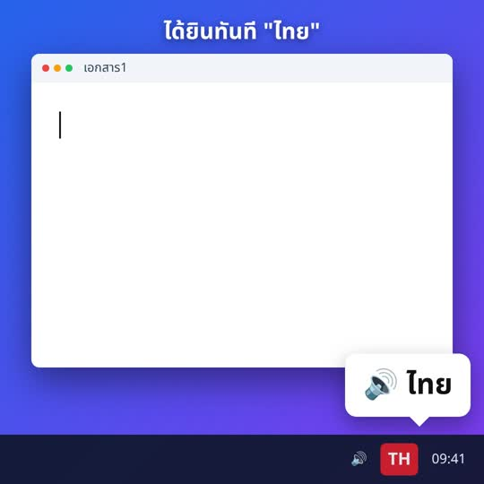
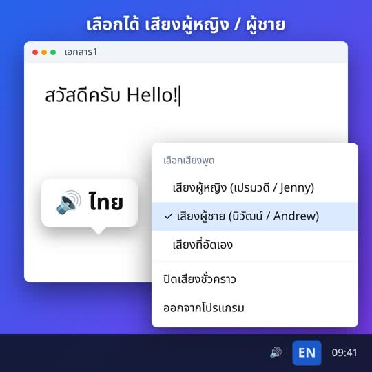

# LangVoice 🔊 พูดบอกทุกครั้งที่สลับภาษา ไทย / English

เคยพิมพ์ไปตั้งยาวแล้วเพิ่งรู้ว่าลืมสลับภาษา จนคำว่า "สวัสดี" กลายเป็น `l;ylfu` ไหม?
**LangVoice** เป็นโปรแกรมเล็กๆ บน Windows ที่จะ **พูดบอก** ทันทีเมื่อคุณสลับภาษาแป้นพิมพ์:
สลับเป็นไทยจะได้ยิน **"ไทย"** สลับเป็นอังกฤษจะได้ยิน **"English"**

<p align="center"></p>

## ✨ จุดเด่น
- ✅ **ฟรี** ติดตั้งง่าย ดับเบิลคลิกไฟล์เดียว
- ✅ **เลือกเสียงได้:** เสียงผู้หญิง, เสียงผู้ชาย หรืออัดเสียงตัวเองจากไมโครโฟน
- ✅ **มีไอคอน TH / EN** ข้างนาฬิกา ดูภาษาปัจจุบันได้ตลอด
- ✅ **ใช้ได้ทุกโปรแกรม** เช่น Word, Excel, Chrome, LINE
- ✅ **เล็กและเบา:** ใช้ CPU แทบเป็นศูนย์ **ไม่ต่ออินเทอร์เน็ต ไม่เก็บสิ่งที่คุณพิมพ์**
- ✅ รองรับ **Windows 10 / 11**

## 📥 ดาวน์โหลดและติดตั้ง
1. ดาวน์โหลด **[LangVoice.zip (เวอร์ชันล่าสุด)](https://github.com/phusitk/langvoice/releases/latest/download/LangVoice.zip)**
2. แตกไฟล์ zip (คลิกขวา > Extract All)
3. ดับเบิลคลิก **`install.bat`**
4. จะมีไอคอน **TH** หรือ **EN** ขึ้นที่มุมขวาล่างข้างนาฬิกา (ถ้าไม่เห็น ให้กดลูกศร ^) แล้วลองกดสลับภาษาได้เลย

> **ถ้า Windows ขึ้นหน้าต่าง "Windows protected your PC":** ให้กด **More info** แล้วกด **Run anyway**
> คำเตือนนี้ขึ้นเพราะเป็นโปรแกรมที่ทำเอง ยังไม่ได้ซื้อใบรับรองดิจิทัล ดูรายละเอียดได้ที่หัวข้อ [ความปลอดภัย](#-ความปลอดภัย)

โปรแกรมจะเปิดเองทุกครั้งที่เปิดเครื่อง ถ้าต้องการถอนการติดตั้ง ให้ดับเบิลคลิก `uninstall.bat`

## 🖱️ วิธีใช้
คลิกขวาที่ไอคอน TH / EN ข้างนาฬิกาจะมีเมนูดังนี้:

| เมนู | ใช้ทำอะไร |
|---|---|
| เลือกเสียงพูด | เสียงผู้หญิง (เปรมวดี / Jenny), เสียงผู้ชาย (นิวัฒน์ / Andrew) หรือเสียงที่อัดเอง |
| ปิดเสียงชั่วคราว | หยุดพูดไว้ก่อน แต่ไอคอนยังแสดงภาษาอยู่ |
| แจ้งเตือนเมื่อสลับหน้าต่างด้วย | ถ้าปิด จะพูดเฉพาะตอนกดสลับภาษาเท่านั้น |
| ทดสอบเสียง | ฟังเสียง "ไทย" / "English" |
| เปลี่ยนเสียง / อัดเสียงเอง... | อัดเสียงตัวเองจากไมโครโฟน (โปรแกรมตัดช่วงเงียบและปรับความดังให้) |

<p align="center">
  
  
</p>

## 🔒 ความปลอดภัย
- **ไม่ใช่ keylogger:** ไม่ดักจับปุ่ม และไม่อ่านสิ่งที่คุณพิมพ์ ทุก 0.15 วินาทีโปรแกรมถาม Windows แค่ว่า "หน้าต่างที่ใช้อยู่ตอนนี้ใช้ภาษาอะไร" ผ่าน `GetKeyboardLayout` เท่านั้น
- **ไม่ต่ออินเทอร์เน็ต** ไม่ขอสิทธิ์ Administrator และไม่แก้ Registry
- **ตรวจสอบได้:** ไม่มีไฟล์ `.exe` สำเร็จรูปในชุดติดตั้ง ตัวติดตั้งคอมไพล์โปรแกรมบนเครื่องคุณเองจาก [`LangVoice.cs`](LangVoice/LangVoice.cs) ด้วย `csc.exe` ที่มากับ Windows คุณจึงเปิดอ่านโค้ดทั้งหมดได้
- **ติดตั้งในโฟลเดอร์ผู้ใช้:** ไฟล์ทั้งหมดอยู่ใน `%LOCALAPPDATA%\LangVoice` และมี shortcut ในโฟลเดอร์ Startup

## 🛠️ สำหรับนักพัฒนา
```
LangVoice/
├── LangVoice.cs        โปรแกรมหลัก (C# 5, WinForms, ทำงานที่ system tray)
├── install.ps1 / .bat  คอมไพล์ คัดลอกไฟล์ และตั้งให้เปิดอัตโนมัติ
├── make-sounds.ps1     เครื่องมืออัดเสียงหรือสร้างเสียงเอง
├── uninstall.ps1 / .bat
├── voices/             ไฟล์เสียงหญิงและชาย (WAV 24 kHz mono)
└── sounds/             วาง thai.wav / english.wav ของคุณเองที่นี่ (ไม่บังคับ)
```
ทุกครั้งที่ push จะมี GitHub Actions คอมไพล์ทดสอบบน Windows ให้
ถ้า push tag `v*` (เช่น `v1.0.0`) ระบบจะสร้าง `LangVoice.zip` และแนบไปกับหน้า Release ให้อัตโนมัติ

## 📄 License
[MIT](LICENSE) (เฉพาะซอร์สโค้ด) ไฟล์เสียงในโฟลเดอร์ `voices/` สร้างด้วยเสียงสังเคราะห์ Neural ของ Microsoft
